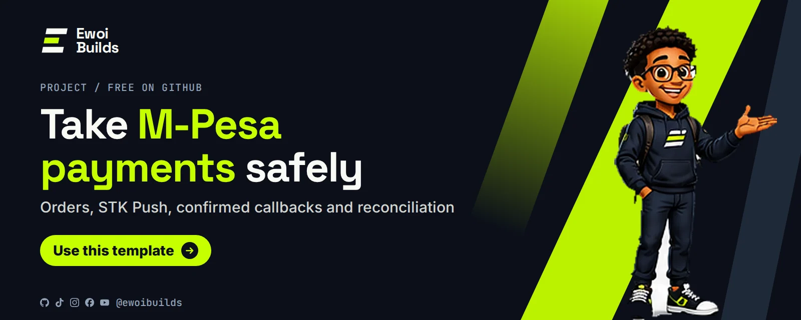

<!-- ewoi:top -->
<p align="center"></p>

<p align="center">
  <a href="https://github.com/ewoibuilds/mpesa-checkout-api/generate"><b>Use this template &rarr;</b></a> &nbsp;&middot;&nbsp;
  <a href="https://github.com/ewoibuilds"><b>All free repos</b></a> &nbsp;&middot;&nbsp;
  <a href="https://www.youtube.com/@ewoibuilds"><b>Watch the lessons</b></a>
</p>

<p align="center">
  
  
  
</p>
<!-- /ewoi:top -->

# M-Pesa checkout API

**Learn. Build. Ship.** An Ewoi Builds project: a Laravel 13 shop API that takes orders, asks for payment with M-Pesa Express (STK Push) and marks an order paid only after the payment is confirmed.

## What you will build

A customer creates an order, pays with an M-Pesa prompt on their phone, and the order becomes **paid** only when Safaricom's own status query agrees. Only a confirmed answer from Safaricom moves a payment to a final state. Repeated results, double taps and confirmed cancels are settled automatically; anything unclear (no answer, an unknown result code, a wrong amount, a success for a closed payment) stays waiting or goes to a `needs_review` list for a person, never silently to paid or failed. Tests prove each path without ever calling Safaricom.

Project guide: [M-Pesa checkout API](https://ewoibuilds.com/projects/mpesa-checkout-api)

## Start here

| Milestone | Folder | Guide steps | Done when |
|---|---|---|---|
| 01 | [`milestone-01-orders`](milestone-01-orders) | Steps 1 to 3 | `OrdersTest` passes |
| 02 | [`milestone-02-pay-once`](milestone-02-pay-once) | Step 4 | `PayTest` passes |
| 03 | [`milestone-03-callback-and-confirm`](milestone-03-callback-and-confirm) | Step 5 | `CallbackTest` passes |
| 04 | [`milestone-04-reconcile`](milestone-04-reconcile) | Steps 6 and 7 | `ReconcileTest` and every other test pass |

The full checklist is in [ACCEPTANCE.md](ACCEPTANCE.md).

## What you need

- A laptop or desktop and a stable internet connection
- Operating system: Windows 10 or 11, macOS or Linux
- Prerequisites: the [Accept M-Pesa payments in Laravel](https://ewoibuilds.com/lessons/mpesa-stk-push-laravel) tutorial
- Tools (search for each on its official site; download only from the official site and check the address):
  - PHP 8.3 or newer and Composer 2: search for "Laravel installation php.new"
  - Git: search for "Git official download"
  - A free Safaricom Daraja developer account, sandbox only: search for "Safaricom Daraja developer portal" (check the address is on safaricom.co.ke)
  - To test with a real phone: a tunnelling tool that gives your laptop a temporary public HTTPS address

This project uses **Laravel 13** and the Daraja **sandbox**. No real money moves.

## Git setup (once)

1. Set your identity: `git config --global user.name "Your Name"` and
   `git config --global user.email "you@example.com"`.
2. To push your own copy, set up an SSH key (`ssh-keygen -t ed25519 -C "you@example.com"`, add the `.pub` key on GitHub, test with `ssh -T git@github.com`) or a fine-grained personal access token used as your password over HTTPS. Keep the private key and the token to yourself.
3. Create your own empty repository on GitHub by hand, then connect your app: `git remote add origin git@github.com:USER/REPO.git`, `git branch -M main`, `git push -u origin main`.
4. Laravel's `.gitignore` already excludes `.env` and `vendor/`. Put the `MPESA_` names from [.env.example](.env.example) in your `.env.example` with `changeme` values, and your real sandbox values only in `.env`.

## How to use this repo

This repo is not a whole Laravel app. Each milestone folder holds the files you create or change, at their real paths, as they should look when that milestone is finished. Create the app as the guide says:

```bash
cd ~/ewoi-learning
composer create-project laravel/laravel mpesa-checkout-api
cd mpesa-checkout-api
php artisan install:api
```

Then at each milestone **compare** its files with yours, or **catch up** by copying its folders (`app`, `config`, `database`, `routes`, `tests`) into your app. Each milestone's `routes/api.php` replaces the one `install:api` made.

## Check it works

From `~/ewoi-learning/mpesa-checkout-api`, with the milestone's `tests/Feature/` files copied in:

```bash
php artisan test
```

Every test should pass. The tests use `Http::fake()` and `Http::preventStrayRequests()`: a request that is not faked fails the test instead of reaching Safaricom.

To try it by hand (milestone 02 onwards), fill `.env`, then run `php artisan migrate`, `php artisan db:seed --class=ProductSeeder`, `php artisan serve`, `php artisan queue:work` and your tunnel.

## Project structure

```
milestone-01-orders/                products, orders and order items; create and show orders
milestone-02-pay-once/              + Mpesa service, payments, the rate-limited pay endpoint
milestone-03-callback-and-confirm/  + the callback and the confirmation job that settles the order
milestone-04-reconcile/             + payments:reconcile every five minutes, review after 24 hours
```

## Troubleshooting

| Problem | Fix |
|---|---|
| `The M-Pesa setting ... is empty` | Fill the `MPESA_` values in `.env`, then `php artisan config:clear` |
| Pay returns 409 | The order is already being paid or is paid; create a new order |
| No callback arrives | `APP_URL` must be your public HTTPS tunnel address, and the tunnel must be running |
| Payment stays `pending` | Run `php artisan queue:work`; the confirmation job runs on the queue and retries until Safaricom gives a final answer |
| A payment shows `needs_review` | The app could not prove the outcome (no answer, wrong amount, success after a close, or 24 hours without a final answer). Check it in the Daraja portal or your M-Pesa statement before you change anything |
| Pay returns 429 | Too many prompts for one phone (3 in 10 minutes) or requests from one address (10 a minute); wait and retry. Behind a proxy, configure trusted proxies so addresses are real |
| Pay returns 503 | The result token is the placeholder or too short, or Safaricom refused an access token; nothing was charged and the order is unchanged |
| `MPESA_CALLBACK_TOKEN must be a random value` | Generate one with `php -r "echo bin2hex(random_bytes(32));"` and put it in `.env` |
| `UNIQUE constraint failed: payments.checkout_request_id` in your own tests | Your fake returns the same `CheckoutRequestID` for two payments; use `Http::sequence()` |

## Using AI on this project

Know the payment states first, then ask for review, not code. A good prompt:

> I am building an M-Pesa STK Push checkout in Laravel 13. Here is my callback route and confirmation job: [paste them]. Do not rewrite them. Find any path where an order could be paid twice, paid with the wrong amount, or stuck forever, and explain each simply.

Check every answer against the guide and the official docs (laravel.com/docs, developer.safaricom.co.ke). Never paste keys, passkeys or your `.env` into a prompt.


## Licence

MIT. See [LICENSE](LICENSE).

<!-- ewoi:end -->
## Keep going

- **Star this repo** so you can find it again, and so more learners discover it.
- **Follow [Ewoi Builds on GitHub](https://github.com/ewoibuilds)** to get the next steps and projects as they land.
- **Build it, then show it:** push your version to your own GitHub and share the link with us.
- **Stuck?** Open an issue with the "I am stuck" form. Say which step, what you ran and what you saw.
- **Lessons stay free.** If this helped, you can say thanks with [Buy me a soda](https://buymesoda.com/Rd3JwfQpNGaUXdyc4ImyIrXrENu2) or [Buy me a coffee](https://buymeacoffee.com/ewoibuilds).

Follow along: [GitHub](https://github.com/ewoibuilds), [TikTok](https://www.tiktok.com/@ewoibuilds), [Instagram](https://www.instagram.com/ewoibuilds/), [Facebook](https://www.facebook.com/profile.php?id=61596671420317), [YouTube](https://www.youtube.com/@ewoibuilds).

**Learn. Build. Ship.**
<!-- /ewoi:end -->
